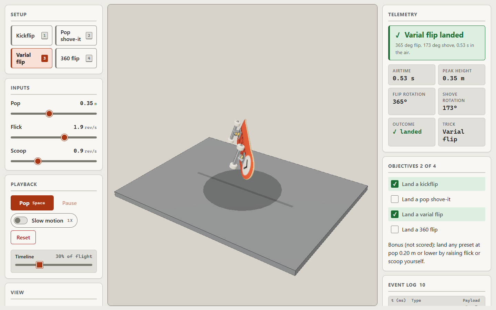
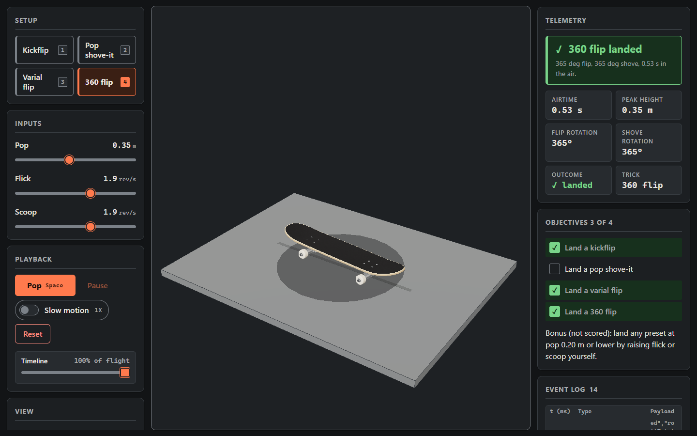
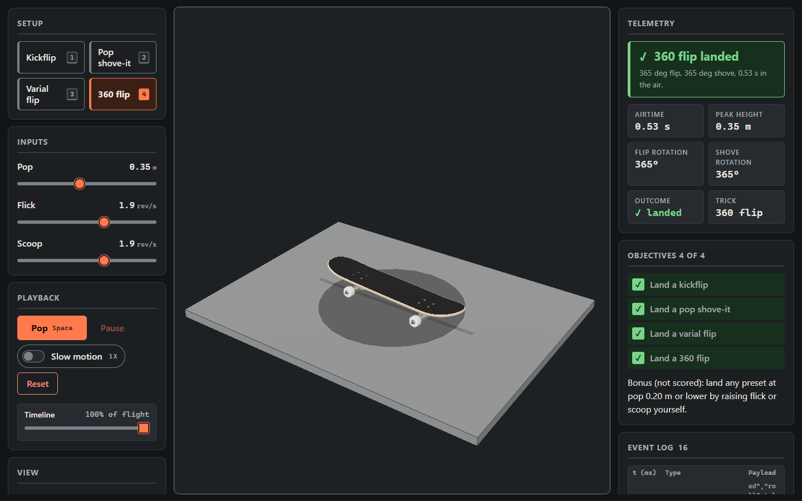
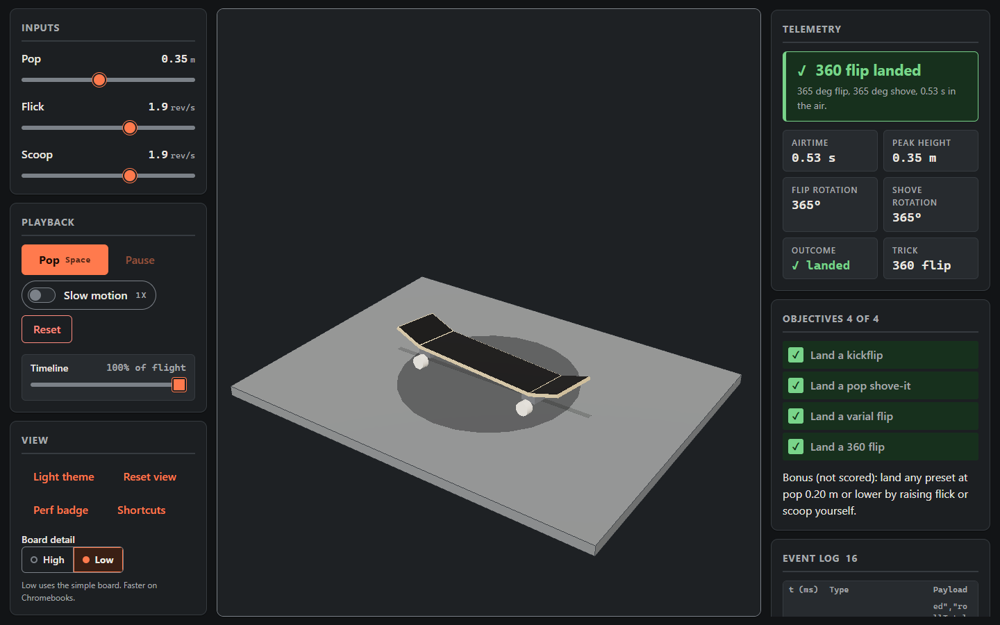

# Trick Lab: land the trick

A browser 3D physics lab about rotation during projectile flight, told through skateboard flip tricks. A student sets three inputs (pop height, flick rate, scoop rate), pops, watches the board fly and rotate, and the app recognizes which trick happened (kickflip, pop shove-it, varial flip, 360 flip, and others) and whether it was landed. Four objectives are scored on the fly, every action is logged, and the log exports as JSON.

Built on 2026-11-04 with React Three Fiber for low-end Chromebooks, accessibility first, with AI-assisted development. It is a demo, not a game engine.

## Screenshots

| | |
| --- | --- |
|  |  |
| Kickflip at 50 percent of the flight: graphic up (dark theme) | Varial flip at 30 percent (light theme) |
|  |  |
| 360 flip landed | 900 px wide: stage, setup, results stacked |
|  |  |
| Keyboard only: 1 Space, 2 Space, 3 Space, 4 Space, all four objectives done | The GLB board from below (debug camera, pad hidden): graphic with the nose disc at +X, trucks, wheels |
|  |  |
| Board detail Low: the primitive board and the View panel's segmented control | Close-up (debug camera): seven plies with the dyed centre ply, aluminium and steel truck, amber bushing, wheel lips and bearing |

## Run it

```
npm install
npm run dev           # Vite dev server
npm run verify        # typecheck + lint + tests + asset budget check
npm run build         # typecheck, then production build to dist/
npm run preview       # serve dist/
npm run assets        # rebuild public/models/board.glb from src/asset/ (committed, so optional)
npm run assets:check  # print the board's budget table, fail on any miss
```

Node 22. Keys: `1` to `4` presets, `Space` pop, `s` slow motion, `r` reset, `t` theme, `p` perf badge, `?` shortcuts.

## Architecture

```
src/sim/     pure physics (flight.ts), recognition, presets, objectives (tricks.ts), text (format.ts)
src/store/   one Zustand store: inputs, playback, assessment, ui slices; export.ts
src/asset/   pure board geometry and textures (deck outline, kicks, concave, trucks, wheel lathe, grip noise), every number in spec.ts
src/scene/   R3F: TrickScene (Canvas), Pad, Board (BoardModel GLB or BoardPrimitive), FlightDriver, SceneCamera, SceneEnvironment, PerfProbe, artDirection, resources
src/ui/      DOM: presets, sliders, playback, telemetry, objectives, event log, announcer, dialogs
scripts/     build-board.ts (npm run assets), check-assets.ts (npm run assets:check), lib/ (build, PNG encoder, inspect, budget)
public/models/board.glb   the generated, committed board
```

### The board asset pipeline

The skateboard is a real GLB built by a script, not JSX boxes. Honestly: it is procedural and scripted (no artist, no Blender). Pure modules in `src/asset/` compute a popsicle deck from nested outline rings (8.0 x 31.75 in, 20 and 19 degree kicks, 12 mm concave, seven plies on the bevelled edge), trucks, bolts and lathed wheels, and generate seeded textures. `scripts/build-board.ts` rasterizes the deck graphic SVG with resvg, assembles a glTF-Transform document with one mesh per material, compresses it with meshopt plus quantization and writes `public/models/board.glb`. `scripts/check-assets.ts` enforces the budget in `npm run verify`: 250 KB of 300, 7 draw calls of 8, 13,904 triangles of 25,000, 4 power-of-two mipmapped textures, about 2.7 MB of GPU texture memory, meshopt required, Draco forbidden, size and rest height within tolerance. The runtime loads it the production way: drei `useGLTF` with the bundled meshopt decoder, a preload, Suspense with the primitive board as the fallback, an error boundary, `dispose={null}` on the cached asset, and one RoomEnvironment PMREM so the metal reads as metal. Details in `docs/ASSET-PIPELINE.md`, decisions in ADR-12 to ADR-15.

- **The sim is pure.** No React, no three. Every number on screen comes from `computeFlight` and `recognize`, which are unit tested.
- **Store actions own the event log.** `applyPreset`, `setInput`, `popTrick`, `land`, `commitScrub` and `resetSession` are the only writers; components select and call.
- **One per-frame writer.** `FlightDriver` advances progress with the frame delta, writes the board pose into a ref, applies it to the board and its shadow disc, commits progress to the store at most 10 times a second, and calls `land()` at the end. No React state changes per frame.
- **Demand rendering.** `frameloop` is `"always"` only while a trick is playing. Idle costs zero frames.
- **Code-split 3D.** The DOM lab paints and is fully usable before the three.js chunk arrives.

## The physics model and its simplifications

- Airtime `T = 2 * sqrt(2h / g)`, height `y(t) = h * (1 - (2t/T - 1)^2)`, g = 9.81.
- Flip (roll about the board's long axis) and shove (yaw about vertical) turn at constant rates: `rollTotal = flick * T * 360`, `yawTotal = scoop * T * 360`.
- Euler order YXZ, so the flip axis follows the shove (ADR-2).
- Direction (ADR-10): regular stance, toe side toward the camera. A kickflip rolls the grip toward the heel side; scoop spins the tail behind the heels, clockwise seen from above (backside). The scene description says this in words.
- Recognition rounds to whole flips and half shoves; landed if within 30 degrees of flip and 25 of shove; otherwise under- or over-rotated on the axis furthest off.
- Simplified away: drag, the feet catching the board, the board's real inertia (no tumbling or wobble), and horizontal travel. Pitch is cosmetic.

## Accessibility

- The canvas is `aria-hidden`; a visually hidden `#scene-description` carries the board state, inputs and last outcome.
- One polite live region announces presets, pops and outcomes in plain language ("Kickflip landed. 365 degrees of flip, 0 degrees of shove, 0.53 seconds in the air.").
- Native range sliders with visible labels and spoken units (`aria-valuetext`).
- Focus stays put after a preset or a result; after reset it moves to the setup heading. Space pops only when focus is not on a slider, button or other control where Space already means something. Shortcuts are inert while the dialog is open.
- `prefers-reduced-motion`: no playback at all. A pop resolves at once, the board shows its final pose, and the timeline steps through the flight.
- Contrast ratios for both themes are documented beside each token (see `docs/DESIGN.md`).
- "Board detail" (High / Low) is a native radio group in a `fieldset` with a legend and a described-by hint, so Tab reaches it, arrow keys switch it, and the change is announced. It is disabled, showing Low, if the model fails to load.

## Performance

Chromebook target. Under 20 draw calls, no shadows, one directional and one ambient light plus a one-time environment map, one mesh per material, no per-frame allocations, DPR capped at 1.5, low-power GPU hint, no MSAA. Measured on the production build (desktop Chromium with an RTX 3060, 2026-11-04, not a Chromebook): **11 draw calls and 13,952 triangles with the GLB board** (9 and 436 before, and again on Low); `gl.render` median 0.2 ms per frame during a trick (1.0 ms at 6x CPU throttle); **0 frames rendered in 10 idle seconds** after a landing; geometries and textures flat at 16 and 6 across 10 trick cycles and repeated Low/High toggles; heap 6.1 MB at load, 7.6 MB after 10 cycles. Full table in `docs/PERF-BUDGET.md`.

## Testing

Vitest with React Testing Library against the real store (only the canvas is stubbed): physics and recognition tables, every preset landing at 0.35 m and failing at 0.15 m, store actions and the event log, keyboard flows (key 1, Space, s, r, t, p, ?), reduced-motion scrubbing, one scrub event per keyboard gesture, the 200-row log panel cap, rotation direction on the real Euler math, camera framing at the measured stage aspects, and a check that each theme's `--scene-bg` token matches the scene clear color.

The asset pipeline is tested on real properties, not snapshots: deck length and width within 2 mm, the design's outline and kick check values, 20 and 19 degree tip angles, zero slope where each kick starts, 12 mm concave, 11.5 mm thickness, z symmetry, outward winding on every triangle, no zero-area triangles and no NaN, grip normals up and graphic normals down, graphic UVs the right way round, wheel bottoms on the pad at the rest height, the bolt pattern and wheelbase, lathe UVs by point index, deterministic textures, a lossless PNG round trip, every budget rule, deterministic GLB bytes, and that the committed GLB still matches the geometry source. The Board detail setting is tested in the store (persisted, announced, never logged) and in the UI (arrow keys, labels, disabled state).

## AI workflow

The lead wrote the brief; a design agent (fable) wrote the tokens, styles and scene numbers; an implementation agent (opus) wrote the code, tests and docs; an independent integration agent (opus) verified in a real browser, found and fixed camera framing, the kickflip direction, per-keypress scrub logging and two CSS clips, and measured the perf numbers. For the realistic board, the design agent (fable) wrote DESIGN.md section 7 and the source SVGs, and an implementation agent (opus) built the pipeline, runtime, tests and docs and checked them in a browser. `CLAUDE.md` holds the rules every agent works to. Honest account in `docs/AGENT-WORKFLOW.md`.

## What this is not

Not a skateboarding game, not a rigid-body simulation, not measured on a real Chromebook yet, and not a shipped product.

## Why skateboarding

Two-axis rotation is a clean, very visual physics lesson: the student changes one rate or the height and sees directly why the board under- or over-rotates. The trick taxonomy (kickflip is one flip, a shove-it is a half shove, a 360 flip is both) turns recognition and assessment into something concrete that a student can name.

## Engineering notes

1. Pure sim, store, scene, DOM: four layers with one-way dependencies; the sim is tested without React or three.
2. One `useFrame` writes the pose to a ref; React re-renders about five times per trick, not sixty.
3. `frameloop` flips to `"always"` only while playing; the delta is clamped because the R3F clock runs during demand idle.
4. Euler order YXZ is the difference between a varial flip and a wobble.
5. Store actions are the only writers of the event log, so the export is a trustworthy assessment record.
6. Reduced motion is a different interaction (scrub), not a slower animation.
7. Space-to-pop respects native control semantics; shortcuts go quiet while the modal dialog is open.
8. One mesh per material: 11 draw calls for the whole scene with a 51-part board, a flat disc instead of shadow maps.
9. The theme test reads `tokens.css` so the CSS stage color and the WebGL clear color cannot drift.
10. Agents worked in parallel from one brief with a class-name contract; `CLAUDE.md` turns review findings into rules.
11. **The asset pipeline is code.** Pure geometry modules, a build script and a checker: the board GLB is deterministic, reviewed like any diff, and its tests check physical properties (2 mm tolerance on size, kick angles, wheels on the pad).
12. **Budgets enforced in verify.** `npm run assets:check` fails the build on file size, draw calls, triangles, texture count, size, power of two, mipmaps or missing compression, so a heavier asset cannot slip in unnoticed.
13. **Meshopt over Draco.** drei's Draco path fetches its decoder from a CDN that school filters block; the meshopt decoder is in the bundle and works offline. KTX2 is the next step and the exact command is in ADR-14.
14. **Fallback and detail level as LOD.** The primitive board is the Suspense fallback, the error fallback and the "Low" setting; on Low the loader chunk and the GLB are never fetched.
15. **Cache-aware disposal.** `dispose={null}` on the useGLTF asset because the cache owns it; the PMREM is built once and disposed on unmount; geometry and texture counts stay flat across toggles, measured.
