# Trick Lab: land the trick

[](https://github.com/Vibin-LLC-2025/trick-lab/actions/workflows/verify.yml)
[](https://github.com/Vibin-LLC-2025/trick-lab/actions/workflows/deploy.yml)
[](LICENSE)

**[Try it live](https://vibin-llc-2025.github.io/trick-lab/)** · runs in any modern browser, no install

A browser 3D physics lab about rotation in projectile flight, taught through skateboard flip tricks. Set the pop height, flick rate and scoop rate, pop, and watch the board flip and spin under the rider's feet. The lab names the trick you made and tells you whether you landed it, or which way you over- or under-rotated.

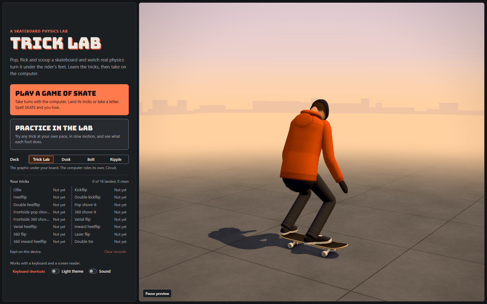

## Features

- **Physics you can see.** Airtime, height, flip and shove come from a small, pure, unit-tested model. Change one slider and the result changes for a visible reason.
- **Two ways in.** The app opens on a welcome screen with a live preview of the board doing tricks: play a game of SKATE, or practice in the lab. Each has its own screen, and the browser's back button moves between them.
- **A calm lab.** The presets, sliders, Pop and the result are up front; speed and timeline, view settings, flight numbers, foot motion, objectives and the event log open when you want them, and stay as you left them.
- **A game of SKATE.** Play the computer by the real rules: a coin flip for who starts, call your trick before you set it, copy or take a letter, two tries on your last letter, and no trick set twice. The computer goes through the same physics as you, missing its aim more on Easy and less on Hard, and takes its go on its own after a short pause. The game screen shows only the game: whose turn it is and the trick in large type, both players' letters, the sliders and Pop. On Easy and Normal the game sets the sliders for each trick you have to do, so timing is the skill; on Hard you set them yourself. Under the sliders a green landing zone shows the flick and scoop that land the trick, and one line says what they make if you time it right ("This makes: kickflip, clean.").
- **A game screen that is a game.** The stage fills the screen, with the turn, the letters and the controls as cards over it, and the computer takes its own turns. Your first game walks you through your first trick in three steps.
- **A board that rolls and lands with weight.** In a game the board pushes off, rolls past a skate spot (a kerb, a rail, a ledge and a wall), pops, and rolls away. A clean landing rolls on, a sketchy one rocks and swerves under the rider, and a bail falls onto its side and slides off while the feet step down. A little dust comes off the wheels.
- **A filmer and an instant replay.** Three camera angles in the game (Filmer, Side, Above), and after a trick you made, the flight once more in slow motion from a low, wide lens. Skip it with Pop or Escape.
- **Your deck, and the computer's.** Pick one of four deck graphics; the computer rides its own, with shoes to match, so whose go it is shows on the board.
- **A pop you have to time.** In a game the sliders say what you are going for. Press Get ready and the timing bar along the bottom of the stage runs; press Pop! in the green band and the board does exactly that; early spins less, late spins more. The computer times the same bar. With sound on you can do it by ear (tick, tick, pop), and "Exact" is one choice away for anyone who would rather not.
- **Records that stay.** The welcome screen lists every trick with what you have done with it on this device (not yet, landed, clean), and the game remembers your wins and losses against each level. Nothing leaves the device, and "Clear records" asks first.
- **Real trick recognition.** 15 named tricks across the kickflip and heelflip families and both shove-it directions, from a kickflip to a double tre. Seven presets, seven objectives, scored as you go.
- **A rider, not a floating board.** The shoes follow the inputs, so the front foot flicks, the back foot scoops, both feet catch the board and land on the bolts, or bail when the trick fails. In the game and on the welcome screen a whole rider stands on them (on High and Medium): crouching, swinging the arms up with the pop, balancing in the air, folding to catch, and stepping off when it bails, in a hoodie and a beanie, the computer in its own colours. The game's camera frames the rider in the part of the stage the cards leave clear and rises with the pop, so the board and the head stay in view. The lab keeps just the legs, so the board stays in view from above.
- **Accessible first.** Every action has a keyboard shortcut and a DOM control, a live region describes each pop and outcome in plain language, and reduced motion turns playback into a scrubbable timeline.
- **Looks and sounds the part.** A street under a real sky with a faint city, a low sun and long shadows; ambient occlusion, motion blur, a glow and a grade on High; a flat, designed look on Low. A bold headline face, the deck's orange, sticker SKATE letters that stamp in, a celebration on a landed trick, and sound (off until you turn it on): recorded pops, catches, landings and bails, and a rolling sound that ticks over the cracks in the concrete.
- **Built for slow hardware too.** Three quality tiers, picked for the device and stepped down by themselves if tricks run choppy: High and Medium draw with the WebGPU renderer, Low with WebGL in under 20 draw calls for a Chromebook. On a touch screen every control is thumb-sized. Models stream as KTX2-compressed glTF, a still of the scene covers the stage while they load, and the renderer draws nothing while idle.
- **Assets as code.** The board, shoes and ground are generated by scripts into compressed glTF and checked against size, triangle and draw-call budgets on every verify.
- **An assessment record.** Every learning action (presets, inputs, pops, results, scrubs, objectives, the game's turns) is logged with a timestamp and exports as JSON; preferences such as the theme, quality and sound are not.

| | |
| --- | --- |
|  | 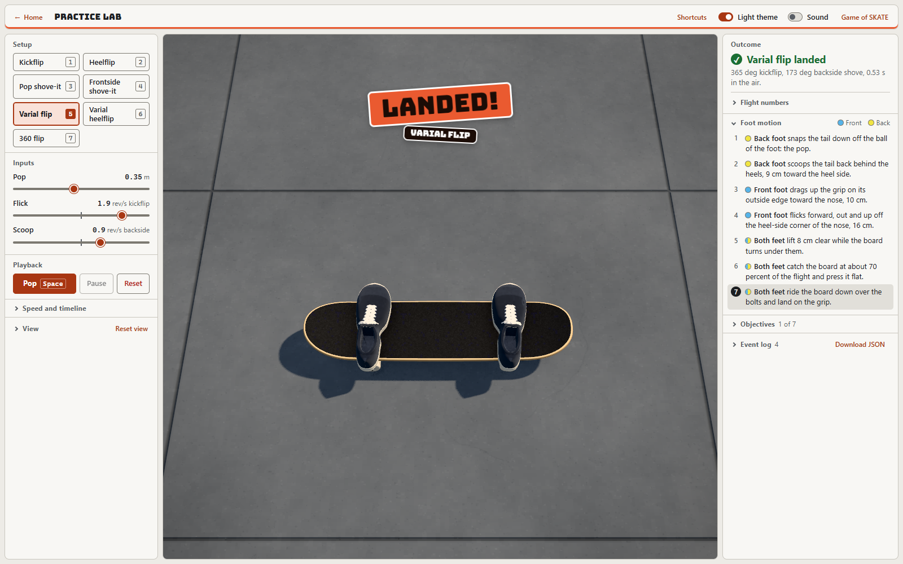 |
| The game: whose turn and the trick, the rider framed clear of the cards | The lab: a landed varial flip, its celebration, and Foot motion open, light theme |

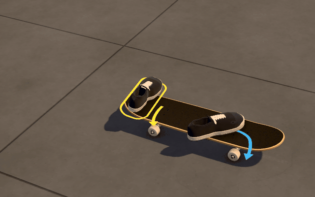

A 360 flip at about a fifth of its speed, stepped through the lab's timeline.

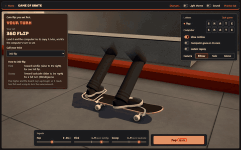

A turn in the game, in slow motion: wind up, pop, land and roll away.

## Quick start

Requires Node 22.

```
git clone https://github.com/Vibin-LLC-2025/trick-lab.git
cd trick-lab
npm install
npm run dev
```

Then open the local URL Vite prints. The welcome screen offers the two ways in: choose Practice in the lab, press `1` for the kickflip preset and `Space` to pop; or choose Play a game of SKATE and press Start game.

**Keys** (`?` lists the ones for the screen you are on):
- Everywhere: `t` theme, `?` all shortcuts.
- In the lab: `1` to `7` presets (kickflip, heelflip, pop shove-it, frontside shove-it, varial flip, varial heelflip, 360 flip), `Space` pop, `s` slow motion, `[` and `]` slower and faster (also mid-trick), `r` reset, `p` perf badge.
- In a game: `Space` pop or the computer's go, `s` slow motion.

| Command | What it does |
| --- | --- |
| `npm run dev` | Vite dev server |
| `npm run verify` | Typecheck, lint, tests, the asset budget check, then a production build and the download budget check (CI runs this) |
| `npm run test:browser` | The browser checks, against the build `verify` made: every screen on every quality level, the draw-call caps, the frames a landing draws, phone and tablet sizes with touch, and a long-run memory test that plays games (Playwright, Chromium only; CI runs them after `verify`) |
| `npm run build` / `npm run preview` | Production build to `dist/`, then serve it |
| `npm run assets` | Rebuild the six GLBs and the deck textures in `public/models` from `src/asset/` (they are committed, so this is optional) |
| `npm run sounds` | Rebuild the recorded sounds in `public/sounds` from the public-domain recordings in `assets/source/sounds` (needs ffmpeg; they are committed, so this is optional) |
| `npm run assets:check` | Print each GLB's budget table and fail on any miss |

New to the code? [`docs/REPO-GUIDE.md`](docs/REPO-GUIDE.md) maps the repo in plain language, [`docs/DECISIONS.md`](docs/DECISIONS.md) records every design decision (ADR-1 to ADR-77), and [`docs/ROADMAP.md`](docs/ROADMAP.md) says what comes next.

## How it works

The rest of this README is the technical detail: the architecture, the asset pipeline, the physics and its simplifications, accessibility, performance, testing and how it was built with AI agents.

The trick names follow the sign of each input (ADR-30): flick positive is the kickflip direction and negative the heelflip, scoop positive is backside and negative frontside. That gives kickflip, heelflip, double kickflip, double heelflip, pop shove-it, frontside pop shove-it, 360 shove-it, frontside 360 shove-it, varial flip, varial heelflip, inward heelflip, 360 flip, laser flip, 360 inward heelflip and double tre. There is no hardflip: the public sources do not agree on how one moves closely enough to build it without guessing, so it was removed (ADR-41, `docs/research/2026-11-05/hardflip.md`); a kickflip with a frontside scoop reads "Unnamed (1 kickflip, 1 frontside half shove)".


## Architecture

```
src/sim/     pure physics (flight.ts), feet (feet.ts), legs (legs.ts) and the rider's body (body.ts), recognition, presets, objectives (tricks.ts), text (format.ts), the game of SKATE (skate.ts)
src/store/   one Zustand store: inputs, playback, assessment, ui, skate slices; export.ts
src/asset/   pure board, shoe, ground and rider geometry and textures (deck outline, kicks, concave, cast trucks, wheel lathe, grip noise), every number in spec.ts, shoeSpec.ts and groundSpec.ts
src/scene/   R3F: TrickScene (Canvas), Pad, Board (BoardModel GLB or BoardPrimitive), Feet, Legs, Rider (RiderModel, the skinned GLB), FootPaths, FlightDriver, SceneCamera, SceneEnvironment, PerfProbe, the sky, the fog, artDirection, resources; nodeRenderer.ts and effects.ts (the WebGPU renderer and its post-processing)
src/audio/   the recorded and synthesized sounds and their Web Audio player
src/ui/      DOM: the welcome screen, the game of SKATE, presets, sliders, playback, telemetry, objectives, event log, announcer, dialogs, the loading picture, the celebration
scripts/     build-board.ts (npm run assets), check-assets.ts (npm run assets:check), lib/ (build, inspect, budget, webp), measure/ (the repeatable measurement), still/ (the loading pictures)
public/models/            the generated, committed GLBs: board.glb (Medium), board-high.glb and shoes.glb (High), ground.glb (the concrete ground, Medium and High), rider.glb (the whole rider, Medium and High)
public/stills/  the loading pictures (three's KTX2 transcoder is emitted into the build by Vite, served from this site)
```

### The board asset pipeline

The skateboard is a real GLB built by a script, not JSX boxes. Honestly: it is procedural and scripted (no artist, no Blender). Pure modules in `src/asset/` compute a popsicle deck from nested outline rings (8.0 x 31.75 in, 20 and 19 degree kicks, 12 mm concave, seven plies on the bevelled edge), trucks, bolts and lathed wheels, and generate seeded textures. `scripts/build-board.ts` rasterizes the deck graphic SVG with resvg, assembles a glTF-Transform document with one mesh per material, compresses it with meshopt plus quantization, encodes its textures as KTX2 (Basis Universal, with full mip chains) and writes `public/models/board.glb`. `scripts/check-assets.ts` enforces the budget in `npm run verify`: 187.6 KB of 300, 7 draw calls of 8, 14,272 triangles of 25,000, 4 power-of-two KTX2 textures, about 0.7 MB of GPU texture memory, meshopt required, Draco forbidden, size and rest height within tolerance. The runtime loads it the production way: drei `useGLTF` with the bundled meshopt decoder and three's KTX2 transcoder served from this site, a download started as soon as the 3D code arrives, Suspense with the primitive board as the fallback, an error boundary, `dispose={null}` on the cached asset, and a procedural outdoor environment map so the metal reads as metal. Details in `docs/ASSET-PIPELINE.md`, decisions in ADR-12 to ADR-15, ADR-48 and ADR-49.

The ground is built the same way (2026-11-04, ADR-31): `src/asset/groundTextures.ts` generates one 1.6 x 1.2 m concrete slab bay (tonal variation, aggregate, pits, hairline cracks, an expansion joint along its edges and a worn painted centre mark) as a grey colour map, a normal map and a roughness map, and `ground.glb` is one 40 x 39.6 m quad that repeats it, under fog to the theme's background colour and a procedural outdoor environment (sky, sun, concrete) in place of RoomEnvironment. Its budget: 143.4 KB of 500, 1 draw call of 1, 2 triangles of 64, 3 textures at 1024 px. Since ADR-40 (2026-11-05) the bays vary: the colour map is a tile of four different bays and the roughness map of nine, each with its own repeat, while the normal map keeps one bay of fine relief. Low draws a flat-shaded plane with the slab joints instead (ADR-54).

| GLB | Tier | Size (limit) | Draw calls (limit) | Triangles (limit) | Textures (limit) |
| --- | --- | --- | --- | --- | --- |
| `board.glb` | Medium | 187.6 KB (300 KB) | 7 (8) | 14,272 (25,000) | 4 (4 at 1024 px) |
| `board-high.glb` | High | 596.2 KB (2.5 MB) | 7 (8) | 47,488 (120,000) | 6 (6 at 2048 px) |
| `shoes.glb` | High | 209.0 KB (600 KB) | 3 (3) | 16,715 (30,000) | 2 (2 at 1024 px) |
| `ground.glb` | Medium and High | 143.4 KB (500 KB) | 1 (1) | 2 (64) | 3 (3 at 1024 px) |
| `rider.glb` | Medium and High, the game and the welcome screen | 98.5 KB (150 KB) | 1 (1) | 18,500 (20,000) | none (none) |

The rider is built the same way (2026-11-11, ADR-85): one skinned mesh over 17 bones lofted round the bind pose in `src/asset/rider.ts`, its colours painted per region at run time, so the player and the computer share the download. `src/sim/body.ts` poses it from the legs' pelvis up, pure and allocation-free.

- **The sim is pure.** No React, no three. Every number on screen comes from `computeFlight` and `recognize`, which are unit tested.
- **Store actions own the event log.** `applyPreset`, `setInput`, `popTrick`, `land` (with the game's scoring), `commitScrub`, `resetSession` and the game's `startSkate` and `quitSkate` are the only writers; components select and call.
- **One per-frame writer.** `FlightDriver` advances progress with the frame delta, writes the board pose into a ref, applies it to the board, the feet and the ground shadow, commits progress to the store at most 10 times a second, and calls `land()` at the end. No React state changes per frame.
- **Demand rendering.** `frameloop` is `"always"` only while a trick is playing, or while the welcome screen's preview plays on Medium and High (it holds a still frame on Low, under reduced motion and while paused). Idle costs zero frames.
- **Code-split 3D.** The DOM lab paints and is fully usable before the three.js chunk arrives.

## The physics model and its simplifications

- Airtime `T = 2 * sqrt(2h / g)`, height `y(t) = h * (1 - (2t/T - 1)^2)`, g = 9.81.
- Flip (roll about the board's long axis) and shove (yaw about vertical) turn at constant rates: `rollTotal = flick * T * 360`, `yawTotal = scoop * T * 360`.
- Euler order YZX: yaw, then the pop pitch, then the flip about the pitched long axis, so the flip axis follows the shove and the nose stays on it during the pop (ADR-32, which replaced ADR-2's YXZ).
- Stance and direction (ADR-10, ADR-24, ADR-25): goofy by default (right foot forward, nose on the right), with a Stance control in the View panel to switch to regular (left foot forward, the board turned so the nose is on the left). The camera stays on the heel side in both. A kickflip rolls the grip toward the heel side, toward the camera; scoop swings the tail toward the heels (backside), counterclockwise seen from above for goofy and clockwise for regular. The scene description says this in words.
- Recognition rounds to whole flips and half shoves; landed if within 30 degrees of flip and 25 of shove; otherwise under- or over-rotated on the axis furthest off. A landing is graded (ADR-63): clean within 10 degrees of flip and 8 of shove, sketchy otherwise, and on the game's Hard level only a clean one counts.
- Rotation is phased (ADR-36): the flip and the shove ramp up just after the pop, spin free at a constant rate, and are caught by the feet at about 70 percent of the flight, so the feet have a moment to catch the board.
- Simplified away: drag, the board's real inertia (no tumbling or wobble), and horizontal travel. Pitch is not part of recognition: the pop pivots the board on its rear wheels until the tail strikes the pad at 32.5 degrees, and nothing passes through the pad (ADR-27). Motion cues on the grip show how each shoe will move against the deck before the pop (ADR-26). The shoes never pass through the board: each one is lifted just clear of the board's actual shape in its pose at that moment, the rails, kicks, wheels and trucks of either board model (ADR-29).

## Accessibility

- The canvas is `aria-hidden`; a visually hidden `#scene-description` carries the board state, inputs and last outcome.
- One polite live region announces presets, pops and outcomes in plain language ("Kickflip landed. 365 degrees of kickflip, 0 degrees of shove, 0.53 seconds in the air."; a varial heelflip reads "365 degrees of heelflip, 173 degrees of frontside shove").
- Native range sliders with visible labels and spoken units (`aria-valuetext`).
- Focus stays put after a preset or a result; after reset it moves to the setup heading, after a screen change to the new screen's title, and when a game starts or ends to the game's heading (at the end the turn controls are gone, so focus goes to the result rather than the page). Space pops only when focus is not on a slider, button or other control where Space already means something. Shortcuts are inert while the dialog is open.
- `prefers-reduced-motion`: no playback at all. A pop resolves at once, the board shows its final pose, and the timeline steps through the flight.
- Contrast ratios for both themes are documented beside each token (see `docs/DESIGN.md`).
- The loading picture and the celebration over the stage are decorative (`aria-hidden`, no pointer events); the live region already says what landed. Sound is off until the student turns it on, with a switch on every screen. A keyboard-only pass through every screen is recorded in `docs/DESIGN.md` 14.10.
- "Quality" (High / Medium / Low) is a native radio group in a `fieldset` with a legend and a described-by hint, so Tab reaches it, arrow keys switch it, and the change is announced. The hint says when the tier was picked for the device. High and Medium are disabled, showing Low, if a model fails to load. "Show feet" is a pressed-state toggle button.
- The feet are described in words: `#scene-description` says where the front and back foot stand for the current sliders ("turned 48 degrees toward the nose with the heel over the heel-side edge"), that they are in the air, and whether they landed on the bolts or bailed.

## Performance

The default target is a desktop GPU; the Low tier keeps the original Chromebook budget. High and Medium draw with three's WebGPU renderer (with post-processing), Low with WebGL: toon shading, no shadow maps, no environment map, one mesh per material, MSAA at DPR 1, a low-power GPU hint, under 20 draw calls. If tricks run choppy on the device's own tier, it steps down one tier by itself and says so. Measured on the production build (desktop Chromium with an RTX 3060, 2026-11-09, not a Chromebook), with feet on: **High 30 and 31 draw calls, Medium 16 and 17, Low 9 and 10** on the welcome screen and in the lab; High's GPU time in a trick **0.9 to 1.8 ms** with occlusion, motion blur and the grade (2.8 to 3.7 ms before them, on WebGL); High downloads **755 KB of models** (2.6 MB before KTX2); **0 frames rendered** after a landing on every tier. At 3 Mbps a still of the scene is on the stage within a second on every tier, until the tier's models are in. Before-and-after tables for every tier, both themes and feet on and off are in `docs/PERF-BUDGET.md` (step 14), including the cost: Medium and High load 220 KB more JavaScript for the WebGPU renderer, so their 3D scene starts later.

Startup: three.js compiles every shader the first time it draws, so the 3D view's first frame used to freeze the page in one long task. It now warms up in separate tasks (lighting map, then shaders compiled in parallel with `compileAsync`) before the board appears, which roughly halved the longest task (Lighthouse mobile on the production build: 95 to 96); Low, which builds no lighting map, shows its first frame at once. Audit `npm run build && npm run preview`, not the dev server. Next steps for low-end devices are in `docs/ROADMAP.md`.

## Testing

Vitest with React Testing Library against the real store (only the canvas is stubbed): physics and recognition tables, every preset landing at 0.35 m and failing at 0.15 m, store actions and the event log, keyboard flows (key 1, Space, s, r, t, p, ?), reduced-motion scrubbing, one scrub event per keyboard gesture, the 200-row log panel cap, rotation direction on the real Euler math, camera framing at the measured stage aspects, and a check that each theme's `--scene-bg` token matches the scene clear color.

The asset pipeline is tested on real properties, not snapshots: deck length and width within 2 mm, the design's outline and kick check values, 20 and 19 degree tip angles, zero slope where each kick starts, 12 mm concave, 11.5 mm thickness, z symmetry, outward winding on every triangle, no zero-area triangles and no NaN, grip normals up and graphic normals down, graphic UVs the right way round, wheel bottoms on the pad at the rest height, the bolt pattern and wheelbase, lathe UVs by point index, deterministic textures, a lossless PNG round trip, every budget rule, deterministic GLB bytes, and that each committed GLB still matches its geometry source. The shoe's size is asserted equal to the feet model's. The feet model is tested on behaviour: the stance follows the sliders, a kickflip flicks the front foot past the heel-side rail while an ollie keeps it over the board, scoop drag scales with the scoop, all four presets land on the bolts, a failed trick bails onto the pad (or onto the failed board where it lies under a shoe), no foot ever jumps more than 3.2 cm per percent of flight against the deck, and no sole is ever inside the board or below the pad (ADR-29). The Quality, Show feet and Show foot trails settings are tested in the store (persisted, announced, never logged, the device auto-pick) and in the UI (arrow keys, labels, disabled state, the scene description).

## AI workflow

The lead wrote the brief; a design agent (fable) wrote the tokens, styles and scene numbers; an implementation agent (opus) wrote the code, tests and docs; an independent integration agent (opus) verified in a real browser, found and fixed camera framing, the kickflip direction, per-keypress scrub logging and two CSS clips, and measured the perf numbers. For the realistic board, the design agent (fable) wrote DESIGN.md section 7 and the source SVGs, and an implementation agent (opus) built the pipeline, runtime, tests and docs and checked them in a browser. `CLAUDE.md` holds the rules every agent works to. Honest account in `docs/AGENT-WORKFLOW.md`.

## What this is not

Not a full skateboarding game (the game of SKATE is a small one on top of the lab), not a rigid-body simulation, not measured on a real Chromebook yet, and not a shipped product.

## Why skateboarding

Two-axis rotation is a clean, very visual physics lesson: the student changes one rate or the height and sees directly why the board under- or over-rotates. The trick taxonomy (kickflip is one flip, a shove-it is a half shove, a 360 flip is both) turns recognition and assessment into something concrete that a student can name.

## Engineering notes

1. Pure sim, store, scene, DOM: four layers with one-way dependencies; the sim is tested without React or three.
2. One `useFrame` writes the pose to a ref; React re-renders about five times per trick, not sixty.
3. `frameloop` flips to `"always"` only while playing; the delta is clamped because the R3F clock runs during demand idle.
4. Euler order YZX is the difference between a varial flip and a wobble, and between a nose that stays put during the pop and one that swings sideways.
5. Store actions are the only writers of the event log, so the export is a trustworthy assessment record.
6. Reduced motion is a different interaction (scrub), not a slower animation.
7. Space-to-pop respects native control semantics; shortcuts go quiet while the modal dialog is open.
8. One mesh per material: 11 draw calls for the first scene with a 51-part board. With the feet on, Low draws 9 or 10, Medium 16 or 17 and High 30 or 31 (High alone uses a shadow map; Medium and Low project soft footprints along the key light, ADR-38).
9. The theme test reads `tokens.css` so the CSS stage color and the WebGL clear color cannot drift.
10. Agents worked in parallel from one brief with a class-name contract; `CLAUDE.md` turns review findings into rules.
11. **The asset pipeline is code.** Pure geometry modules, a build script and a checker: the board GLB is deterministic, reviewed like any diff, and its tests check physical properties (2 mm tolerance on size, kick angles, wheels on the pad).
12. **Budgets enforced in verify.** `npm run assets:check` fails the build on file size, draw calls, triangles, texture count, size, power of two, mipmaps or missing compression, so a heavier asset cannot slip in unnoticed.
13. **Meshopt over Draco, KTX2 served from home.** drei's Draco path fetches its decoder from a CDN that school filters block; the meshopt decoder is in the bundle and works offline, and the KTX2 textures are transcoded by three's own Basis transcoder served from this site (ADR-49). The headline font is self-hosted for the same reason.
14. **Fallback and detail level as LOD.** The primitive board is the Suspense fallback, the error fallback and the "Low" setting; on Low the loader chunk and the GLBs are never fetched.
15. **Cache-aware disposal.** `dispose={null}` on the useGLTF assets because the cache owns them; the PMREM is built once and disposed on unmount; geometry and texture counts stay flat across toggles, measured.
16. **Quality tiers, picked for the device (ADR-16).** The default target moved from a Chromebook to a desktop GPU; Low keeps the Chromebook budget of under 20 draw calls. The Canvas is keyed on the tier because antialias is a context option; every per-tier number is one table in `artDirection.ts`.
17. **Feet from the inputs, not the answer (ADR-17).** A pure, allocation-free feet model turns pop, flick and scoop into two shoe poses per frame, so a wrong slider shows a wrong foot, and a failed trick is a bail. The same `isLanded` rule decides recognition and the bail, so the two can never disagree.
18. **Frame the flight (ADR-18).** The camera fits the board's flight volume, not the pad, which doubled the board's size on screen and removed most of the "pixelated" look before any asset changed.

## More screenshots

<details>
<summary>Development screenshots from 2026-11-04 (earlier shoes, before the legs and the fitted shadows)</summary>

| | |
| --- | --- |
| 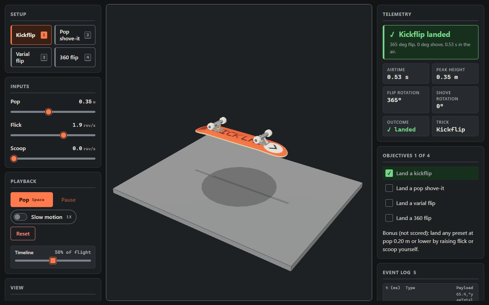 | 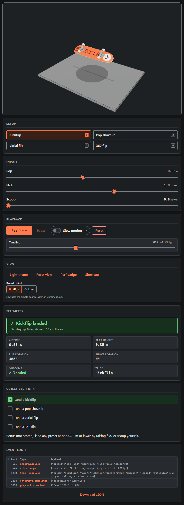 |
| Kickflip at 50 percent of the flight, before the feet | 900 px wide: stage, setup and results stacked |
| 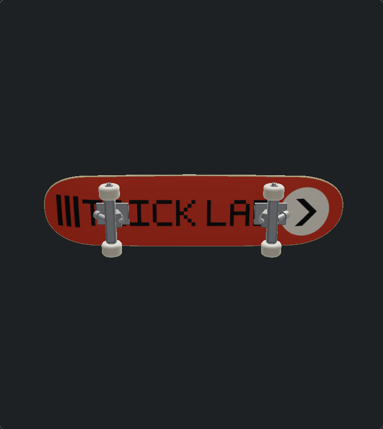 | 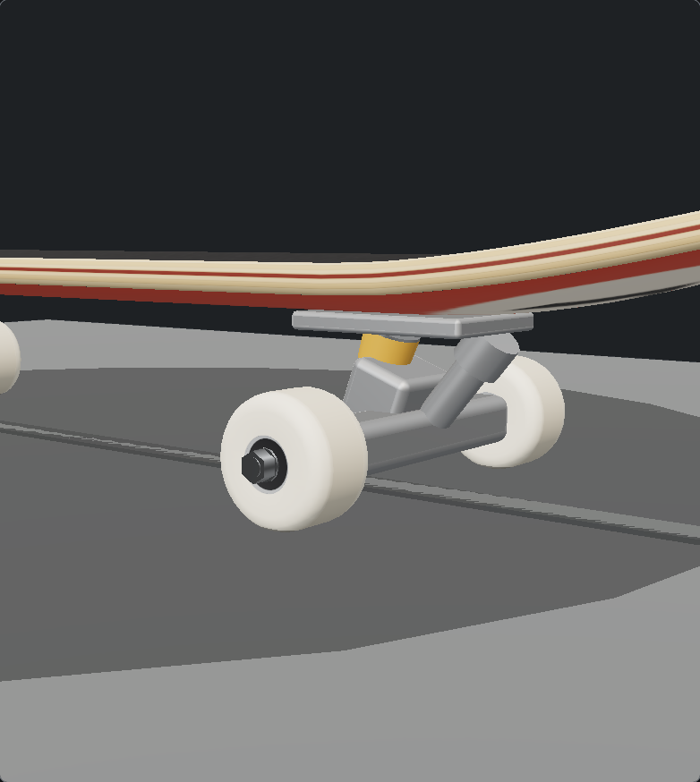 |
| The GLB board from below (debug camera, pad hidden) | Close-up: seven plies with the dyed centre ply, truck, bushing, wheel lips and bearing |
| 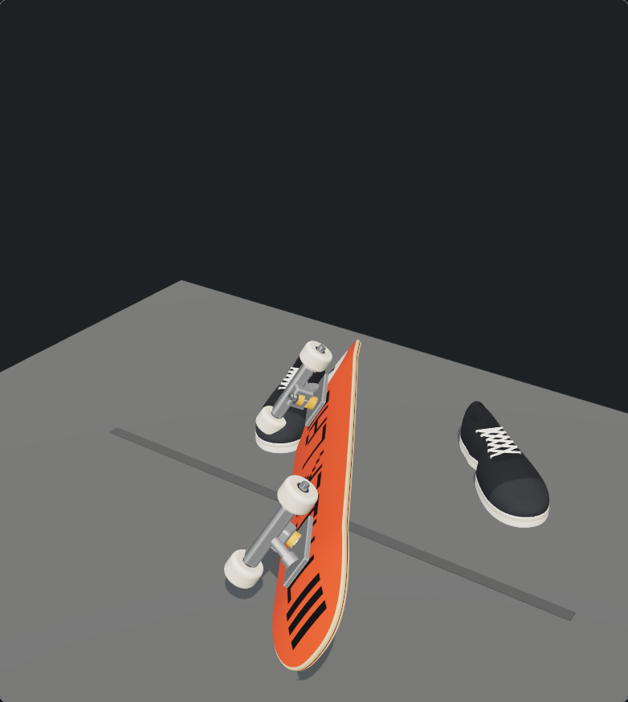 | 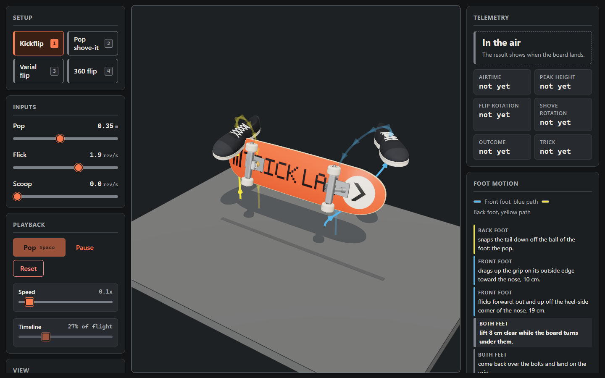 |
| A 360 flip at pop 0.15 m does not land: the feet step off to the heel side (ADR-17) | Foot trails: the path of each shoe against the deck |
| 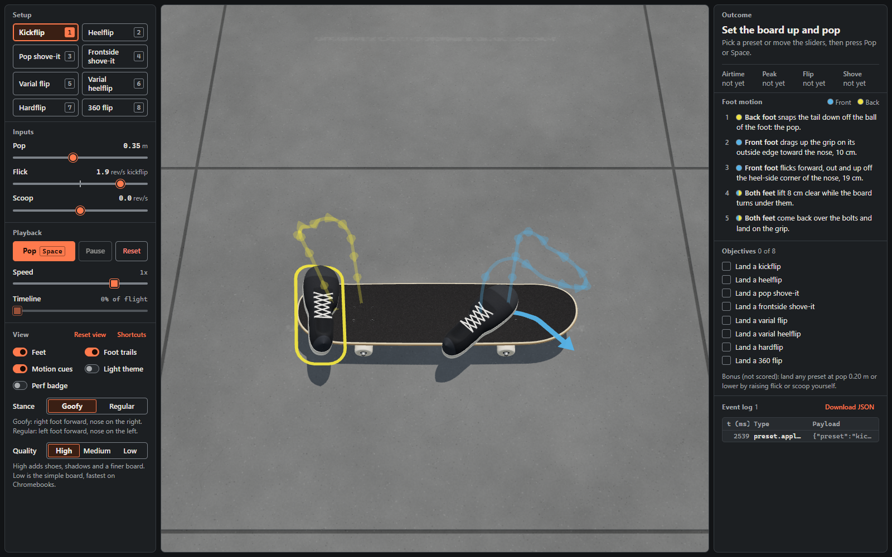 | 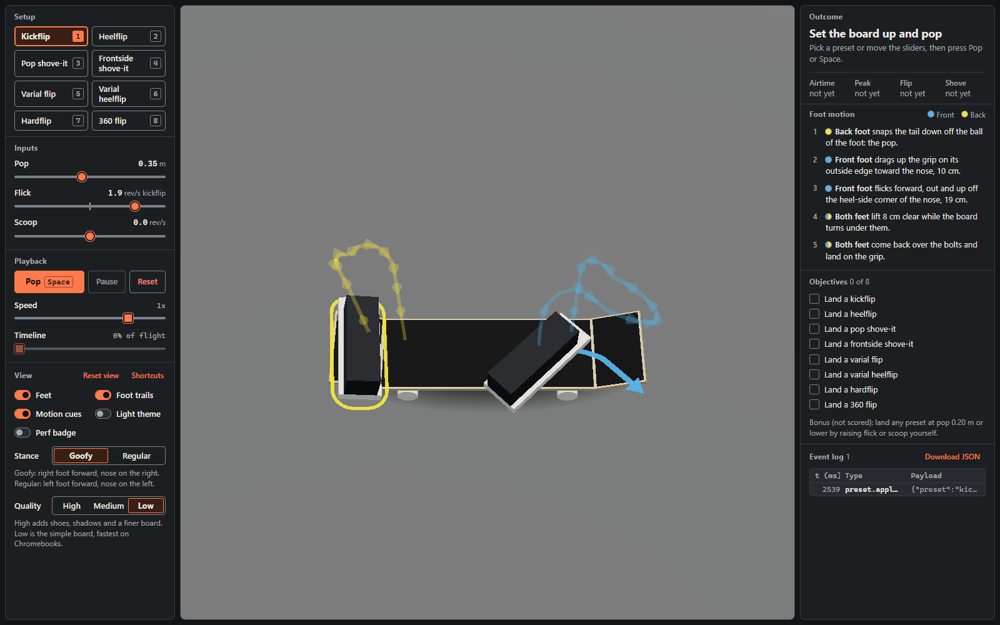 |
| The concrete ground on High (ADR-31) | Quality Low: the primitive board on a plain plane |

</details>

## License

[MIT](LICENSE). Copyright (c) 2026 Vibin LLC.

The headline font, Bungee, is Copyright 2023 The Bungee Project Authors and licensed under the [SIL Open Font License 1.1](src/styles/fonts/OFL.txt).
